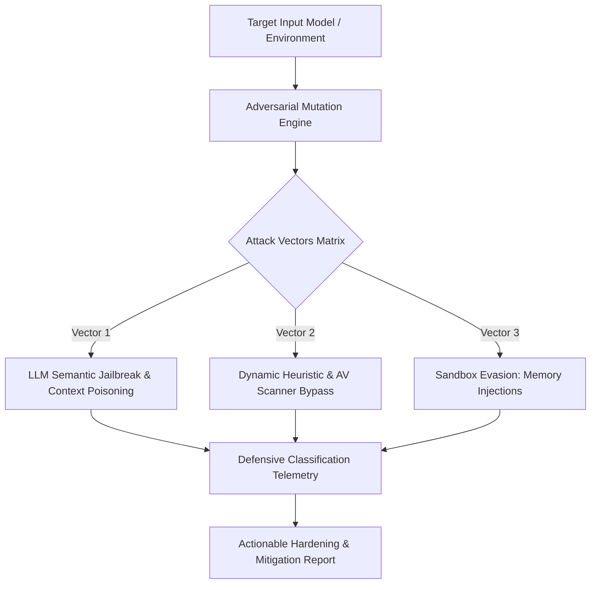

<div align="center">

# ⚡ CRACKREX // AI ADVERSARIAL MATRIX
### Autonomous Red Teaming, Neural Jailbreaking & Defensive Evasion Framework

[](https://opensource.org/licenses/MIT)
[](https://github.com/robat699-cmyk/Crackrex)
[](https://www.typescriptlang.org/)
[](https://github.com/robat699-cmyk/Crackrex)
[](https://github.com/robat699-cmyk/Crackrex)

<br/>

> **"Evaluating tomorrow's AI agents, autonomous decision networks, and endpoint sandboxes against next-generation adversarial mutations."**

</div>

---

## 🔬 System Architecture



---

## 🎯 Key Capabilities & Attack Vectors

### 1. 🤖 Adversarial LLM Jailbreak Auditing
- **Context Window Poisoning**: Stress-tests model guardrails and system prompt boundaries using multi-layered out-of-band token sequences.
- **Semantic Evasion**: Automatically crafts polymorphic prompts designed to elicit policy-restricted responses without triggering keyword filters.

### 2. 🛡️ Dynamic Runtime Evasion Testing
- **Modern Sandbox Probing**: Simulates payload behavior against modern OS sandboxes (including Android 17+ isolation levels and enterprise EDR agents).
- **Anti-Analysis & Debugger Detection**: Validates whether defensive agents detect memory-only payload decoding and process hollowing.

### 3. 📊 Visual Red Team Operational Console
- Modern, high-density React telemetry interface displaying real-time attack surfaces, evasion confidence scoring, and defensive degradation matrices.

---

## 🛠️ Technology Stack

| Layer | Tools & Technologies |
|---|---|
| **User Interface** | React 19, TypeScript, Vite, Tailwind CSS, Framer Motion |
| **Icons & Design** | Lucide React, Matrix Cyberpunk Dark Palette |
| **Logic Engines** | Modular Evasion Payloads, Mutation Pipelines, AST Transforms |
| **Target Coverage** | Endpoint EDRs, Heuristic Scanners, LLM Guardrails |

---

## 🚀 Quickstart & Local Setup

```bash
# 1. Clone repository
git clone https://github.com/robat699-cmyk/Crackrex.git
cd Crackrex

# 2. Install dependencies
npm install

# 3. Environment configuration
cp .env.example .env.local

# 4. Launch interactive console
npm run dev
```

---

## ⚖️ Legal & Ethical Compliance
*Crackrex is developed strictly for authorized security assessments, academic defensive research, and penetration testing under valid rules of engagement. Unauthorized access or hostile testing against third-party systems is illegal.*

---

<div align="center">
  <sub>Engineered by <a href="https://github.com/robat699-cmyk">It's TAWHIDUR (@robat699-cmyk)</a> • Lead Security Researcher</sub>
</div>
